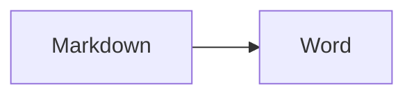

# `md2docx-cli`: the command line

`md2docx-cli` turns Markdown into Word `.docx` files, with **editable LaTeX equations**, **Mermaid
diagrams**, tables, footnotes, syntax-highlighted code, links and your own styles. It is the command-line
front end of the [`md2docx`](README.md) library and the thing to reach for in a shell, a CI job, a build script or an
automated agent.

This page documents **every option, with examples**. `md2docx-cli --help` is the short form; this is the long one.

* [Build and install](#build-and-install)
* [Sample commands](#sample-commands)
* [How it works: the things to know first](#how-it-works)
* [Option reference](#option-reference)
  * [Input and output](#input-and-output) · [Reporting](#reporting) · [Trust and safety](#trust-and-safety) ·
    [Math](#math) · [Diagrams](#diagrams) · [Images](#images) · [Links](#links) ·
    [Page and text look](#page-and-text-look) · [Styles from a reference](#styles-from-a-reference) ·
    [Markdown extras](#markdown-extras) · [Limits and time](#limits-and-time) ·
    [Reproducible output](#reproducible-output) · [Introspection (for scripts and AI)](#introspection-for-scripts-and-ai) ·
    [Shell integration](#shell-integration)
* [Exit status](#exit-status) · [Standard streams](#standard-streams) · [The JSON report](#the-json-report) ·
  [Environment variables](#environment-variables)
* [Recipes](#recipes) · [Using it from scripts and AI agents](#using-it-from-scripts-and-ai-agents) ·
  [Troubleshooting](#troubleshooting)

---

## Build and install

You need a Rust toolchain: install it from <https://rustup.rs> (Rust **1.88** or newer).

**From crates.io** (the normal way):

```sh
cargo install md2docx --locked
md2docx-cli --version
```

The crate is called `md2docx`; the program it installs is `md2docx-cli`. `--locked` uses the dependency
versions the release was tested with.

**With in-process Mermaid** (diagrams drawn inside the program: no browser, no second program; needs Rust **1.95**):

```sh
cargo install md2docx --locked --features mermaid
md2docx-cli --version          # the second line says "mermaid (in-process Mermaid available)"
```

**From a clone of the repository:**

```sh
git clone https://github.com/silvercity-oss/md2docx
cd md2docx
cargo build --release --locked                       # target/release/md2docx-cli
cargo build --release --locked --features mermaid    # the same, with in-process Mermaid
cargo install --path . --locked                      # install what you built
```

**As a container** (a small unprivileged image; see [docs/containers.md](docs/containers.md)):

```sh
docker build -t silvercity-oss/md2docx:local .
docker run --rm -i silvercity-oss/md2docx:local - < notes.md > notes.docx
```

**Prebuilt binaries** for Linux, macOS and Windows are attached to each
[GitHub release](https://github.com/silvercity-oss/md2docx/releases) together with a `SHA256SUMS` file.

**Optional programs.** Nothing below is needed for ordinary documents; each unlocks one feature:

| Program | Needed for | Install |
| --- | --- | --- |
| `latex` + `dvipng` (TeX Live) | `--math-mode image` (equations as pictures) | your TeX distribution |
| `merman-cli` | Mermaid diagrams without the `mermaid` build feature | `cargo install merman-cli` |
| `mmdc` (Mermaid CLI) | `--mermaid-engine mmdc` (needs a headless Chrome) | `npm install -g @mermaid-js/mermaid-cli` |

`md2docx-cli --capabilities` tells you which of these it can find on this machine.

---

## Sample commands

```sh
# 1. The simplest case: writes notes.docx next to notes.md
md2docx-cli notes.md

# 2. Choose the output file
md2docx-cli notes.md -o report.docx

# 3. Pipe in and out (no files)
cat notes.md | md2docx-cli - -o - > notes.docx

# 4. Several files at once, into a folder (the folder must exist)
mkdir -p build && md2docx-cli docs/*.md -o build/

# 5. Lint Markdown in CI: write nothing, fail if anything could not be converted faithfully
md2docx-cli --check --strict docs/*.md

# 6. Convert something you do not trust (an upload, user text): the safe preset
md2docx-cli --untrusted upload.md -o upload.docx

# 7. A machine-readable result for a script
md2docx-cli --format json --check upload.md 2> result.json

# 8. A Letter-size document with a table of contents, numbered headings and page numbers
md2docx-cli notes.md --page-size letter --toc 2 --number-headings --page-numbers

# 9. Syntax-highlighted code in the VS Code Dark+ colours, body text in Georgia 12 pt
md2docx-cli notes.md --highlight dark --body-font Georgia --body-size 12

# 10. Use your company's Word template for fonts and heading looks
md2docx-cli notes.md --reference-doc company-template.docx

# 11. ... or turn the template into an editable JSON file once, then use that
md2docx-cli --extract-reference company-template.docx          # writes company-template.json
md2docx-cli notes.md --reference-style company-template.json

# 12. Equations as pictures through a local TeX install instead of editable equations
md2docx-cli notes.md --math-mode image

# 13. A README with its linked documents and the files they link to, as a self-contained folder
md2docx-cli README.md --markdown-links follow --copy-linked -o site/

# 14. The same document twice gives the same bytes (for build caches and signing)
SOURCE_DATE_EPOCH=1700000000 md2docx-cli notes.md -o notes.docx

# 15. Ask the program what it can do, what it will do, and what it can tell you
md2docx-cli --capabilities
md2docx-cli --print-config --untrusted
md2docx-cli --list-codes
```

---

## How it works

### One command, many inputs

```text
md2docx-cli [OPTIONS] [INPUT]...
```

`INPUT` is a Markdown file, or `-` for standard input. Several inputs are converted one after the other;
every input is tried and the exit status is that of the first one that failed. A few modes need no input:
`--extract-reference`, `--capabilities`, `--list-codes`, `--print-config`, `--completions`, `--man`.

### Trusted and untrusted

The command line **trusts your input by default**: it is for files you wrote. That means it may read images
from the input's folder, call a TeX install or a diagram renderer if you ask, and use generous limits.

For Markdown from anywhere else (a web upload, a chat message, a model's output) add **`--untrusted`**. It
switches to the safe preset: equations stay editable (no program is started), diagram blocks stay code,
no local images are read, raw-HTML links are off, and every limit is tight. You can tighten it further
(`--untrusted --max-input-bytes 500K`) but flags that would loosen it are refused with exit status 2.
`md2docx-cli --print-config --untrusted` shows exactly what the preset sets.

### What "faithful" means

Not everything in Markdown can be carried into Word (a remote image is not fetched, a link to a relative path
is not a working link, an unknown LaTeX command cannot be an equation). The converter does not hide that:
each such case is a **finding** with a stable code, a severity and a line/column, printed as a warning.
By default findings do not stop the conversion. With **`--strict`** any warning refuses the document
(exit status 5) and writes nothing. The codes are in [docs/diagnostics.md](docs/diagnostics.md) and
`md2docx-cli --list-codes`.

### Files are written safely

The output goes to a temporary file and is renamed into place, so a failure never leaves half a `.docx`.
The program refuses to overwrite its own input and refuses to write a `.docx` to your terminal.

---

## Option reference

Options are grouped by purpose. `[default: …]` is what you get when you do not pass the option.
"Env" is the environment variable that sets it, if there is one (a flag on the command line wins).

### Input and output

#### `INPUT…`
Markdown files to convert; `-` reads standard input (UTF-8, up to `--max-input-bytes`). Relative image paths resolve against each file's
own folder (against `--base-dir`, or the current folder, for standard input).

```sh
md2docx-cli chapter1.md chapter2.md          # chapter1.docx, chapter2.docx
md2docx-cli - < notes.md -o notes.docx       # from standard input
```

`-` cannot be combined with other inputs. Two inputs that would write the same file are refused before anything runs.

#### `-o, --output <PATH>`
Where the `.docx` goes. A file name for one input; a **folder** (which must exist, except with `--markdown-links`) for several inputs;
`-` for standard output. `[default: <input>.docx next to the input; standard output for a - input]`.

```sh
md2docx-cli notes.md -o ~/Documents/notes.docx
md2docx-cli a.md b.md c.md -o out/
md2docx-cli notes.md -o - | gzip > notes.docx.gz
```

With `--extract-reference` it names the JSON file instead (see [Styles from a reference](#styles-from-a-reference)).

#### `--check`
Run the whole conversion (same limits, same renderers, same findings) but **write nothing**. Use it as a lint
step. Alone it reports findings and exits 0; add `--strict` to exit 5 on any warning. Cannot be combined with `-o`
(except with `--markdown-links`, where `-o` says where links would point).

```sh
md2docx-cli --check docs/*.md
md2docx-cli --check --strict --format json docs/*.md 2> lint.jsonl
```

#### `--completions <SHELL>` and `--man`
See [Shell integration](#shell-integration).

### Reporting

#### `--format <text|json>`   Env: `MD2DOCX_FORMAT`   [default: text]
How results are reported on **standard error**. `text` prints `file:line:column: warning[code]: message` lines
(the shape editors and CI annotators understand) and a `wrote file.docx` line. `json` prints **exactly one JSON
object per input** and nothing else; see [The JSON report](#the-json-report).

```sh
md2docx-cli notes.md --format json 2> report.json
md2docx-cli docs/*.md --check --format json 2>&1 >/dev/null | jq -r 'select(.diagnostics|length>0) | .input'
```

#### `-q, --quiet`   Env: `MD2DOCX_QUIET`
Text format only: no warnings and no `wrote` line. Errors always print. Has no effect on `--format json`.

```sh
md2docx-cli notes.md -q && echo converted
```

#### `--strict`   Env: `MD2DOCX_STRICT`
Refuse a document that could not be converted faithfully: any warning-level finding (a dropped image or link, a
diagram left as code, an unknown LaTeX command, …) makes the run fail with status **5** and writes nothing. Every
problem is listed with its line and column. Information-level notes (such as "front matter was read") never trigger it.

```sh
md2docx-cli --strict contract.md -o contract.docx      # produce the file only if nothing was lost
md2docx-cli --check --strict docs/*.md                  # the same as a lint
```

### Trust and safety

#### `--untrusted`   Env: `MD2DOCX_UNTRUSTED`
The hostile-input preset (see [Trusted and untrusted](#trusted-and-untrusted)): native math, diagram fences left as code,
no local images, no raw-HTML links, tight limits, a 120 s overall deadline, **no child process is ever started**.
It conflicts with `--math-mode`, `--dolphin-command`, `--mermaid-command`, `--mermaid-engine`, `--latex`, `--dvipng`,
`--image-access`, `--image-encoding`. The limit options may be combined with it, but only to *lower* a limit.

```sh
md2docx-cli --untrusted comment.md -o comment.docx
md2docx-cli --untrusted --max-input-bytes 200K --deadline 10 comment.md
MD2DOCX_UNTRUSTED=1 md2docx-cli comment.md          # the same, for a container's environment
```

#### `--diagrams`
Only with `--untrusted`: also render Mermaid diagrams, in a bounded way. In builds with the `mermaid` feature this happens in-process
(still no child process); otherwise through `merman-cli` (one tightly bounded process per diagram, 20 s each).

```sh
md2docx-cli --untrusted --diagrams architecture.md
```

#### `--link-schemes <LIST>`   [default: http,https,mailto]
Comma-separated URL schemes a link may use; links with any other scheme (or none) are written as plain text and reported as
`link.dropped`. With `--untrusted` the list may only be **shortened**.

```sh
md2docx-cli notes.md --link-schemes https                 # no http:, no mailto:
md2docx-cli notes.md --link-schemes http,https,mailto,tel
```

#### `--no-html-links`
Do not turn raw HTML `<a href>` links into hyperlinks (they are already off with `--untrusted`).

```sh
md2docx-cli notes.md --no-html-links
```

### Math

Inline `$x^2$` and display `$$ … $$` math are LaTeX. They become **native Word equations** (OMML) you can edit in Word.

#### `--math-mode <native|image>`   [default: native]
`native` converts LaTeX in-process: editable equations, no program started. `image` renders each equation to a transparent PNG with a
local TeX install (`latex` + `dvipng`), for the rare formula the native converter does not know. It runs TeX on document content, so
use it only for Markdown you wrote.

```sh
md2docx-cli physics.md                          # editable equations
md2docx-cli physics.md --math-mode image        # pictures; needs latex and dvipng
```

An equation the native converter cannot express (such as a `\begin{CD}` diagram) makes the conversion fail with a message that names the
line; an unknown command inside an otherwise fine equation is shown as text and reported as `math.unknown-command`.

#### `--latex <PROGRAM>` and `--dvipng <PROGRAM>`   [default: latex, dvipng]
The executables used by `--math-mode image`, by name (looked up on `PATH`) or by full path.

```sh
md2docx-cli physics.md --math-mode image --latex /usr/local/texlive/bin/latex --dvipng /usr/local/texlive/bin/dvipng
```

### Diagrams

A fenced block starting ` ```mermaid ` (or ` ```dolphin `) is a diagram. With rendering on it becomes a picture in the document;
with rendering off (`--untrusted`) it stays a code block and is reported as `diagram.not-rendered`.

````markdown

````

#### `--mermaid-engine <merman|mmdc|inprocess>`   [default: merman]
Which program draws Mermaid. `merman` runs `merman-cli` (a Rust renderer: no browser). `mmdc` runs the official Mermaid CLI
(exact Mermaid.js output; drives a headless Chrome). `inprocess` draws inside this program (only in builds with the `mermaid` feature; no child process).
Conflicts with `--mermaid-command`.

```sh
md2docx-cli design.md                                   # merman-cli
md2docx-cli design.md --mermaid-engine mmdc             # official renderer
md2docx-cli design.md --mermaid-engine inprocess        # needs: cargo install md2docx --features mermaid
```

#### `--mermaid-command <TEMPLATE>`
Your own renderer for Mermaid, replacing `--mermaid-engine`. The template is split with shell quoting rules and **must contain `{input}` and `{output}`**
(the diagram source file and the PNG to write); `{dpi}` is optional.

```sh
md2docx-cli design.md --mermaid-command 'mmdc -i {input} -o {output} -p puppeteer.json'
```

On Windows npm installs `mmdc.cmd`; name it explicitly (`--mermaid-command 'mmdc.cmd -i {input} -o {output}'`).

#### `--dolphin-command <TEMPLATE>`
The renderer for ` ```dolphin ` blocks, with the same template rules. [default: `dolphin -i {input} -o {output}`.] There is no standard Dolphin program, so you normally set this to yours; if the program is missing, the run fails with status 6 (or, with `--keep-failed-diagrams`, the block stays code).

```sh
md2docx-cli graphs.md --dolphin-command 'dolphin -i {input} -o {output}'
```

#### `--keep-failed-diagrams`
If a diagram cannot be rendered (the tool is missing, or the diagram is invalid), keep it as a code block and report `diagram.kept-as-code` instead of failing.

```sh
md2docx-cli design.md --keep-failed-diagrams
```

#### `--timeout <SECONDS>`   Env: `MD2DOCX_TIMEOUT`   [default: 60; 20 with `--untrusted --diagrams`]
Kill an external renderer that runs longer than this. The whole process group is ended, including helpers such as Chrome.

```sh
md2docx-cli design.md --mermaid-engine mmdc --timeout 120
```

#### `--scratch-dir <DIR>`   Env: `MD2DOCX_SCRATCH_DIR`
Where temporary working folders for renderers go (the folder must exist). Each conversion makes one `md2docx-…` folder there and removes it; useful for a
read-only root filesystem with a writable `tmpfs`.

```sh
md2docx-cli design.md --scratch-dir /mnt/fast-tmp
```

### Images

Markdown images `` are embedded. Remote (`http:`) and `data:` images are **never fetched**; the alt text is shown and
`image.remote` is reported. Supported files are PNG, JPEG and GIF.

#### `--image-access <none|base-dir|any>`   [default: base-dir]
Which local images may be read. `none` reads no file (images become `[alt text]`). `base-dir` allows only files that resolve, after following
symbolic links, **inside the input's folder** (or `--base-dir`); anything else is an error. `any` allows any readable file: for Markdown you wrote.

```sh
md2docx-cli notes.md                              # images next to or below notes.md
md2docx-cli notes.md --image-access none
md2docx-cli notes.md --image-access any           # trusted notes that include ../shared/logo.png
```

#### `--base-dir <DIR>`   Env: `MD2DOCX_BASE_DIR`
The folder relative image paths resolve against, and that `--image-access base-dir` confines to.
[default: the input file's folder; the current folder for `-`]

```sh
cat notes.md | md2docx-cli - -o notes.docx --base-dir ~/project/images
```

#### `--image-encoding <png|original>`   [default: png]
`png` decodes every picture and writes it again as a clean PNG: metadata (EXIF, GPS, colour profiles) and appended data are dropped, and a camera's EXIF rotation is applied. Photographs grow
several times. `original` embeds PNG, JPEG and GIF files **byte for byte**: exact size, quality and metadata. Files are still fully decoded first, so corrupt files and
every limit behave as before. The cost: whatever the decoder ignores (EXIF with a location, appended data) goes into the document, and the orientation is not applied.
Not allowed with `--untrusted`.

```sh
md2docx-cli report.md --image-encoding original       # keep the photographs as they are
```

#### `--max-image-bytes <BYTES>`   Env: `MD2DOCX_MAX_IMAGE_BYTES`   [default: 25M; 5M with `--untrusted`]
Largest single image file or rendered diagram. Sizes accept `K`, `M`, `G` (binary: `2M` = 2 MiB).

```sh
md2docx-cli report.md --max-image-bytes 100M
```

#### `--max-images <COUNT>`   Env: `MD2DOCX_MAX_IMAGES`   [default: 1000; 100 with `--untrusted`]
Most distinct images in the document.

```sh
md2docx-cli gallery.md --max-images 5000
```

### Links

By default a link must be an absolute address with an allowed scheme (`https:`, `mailto:`; see `--link-schemes`). A relative path such as
`docs/guide.md` is written as plain text and reported as `link.dropped`. The options below are for documents you wrote, where those paths should work.
They are explained fully, with the model and the edge cases, in **[docs/links.md](docs/links.md)**.

#### `--allow-links <none|local|all>`   [default: none]
`local`: a path becomes a link only if it names an **existing** file or folder inside the link root (symlinks resolved) and is not a program or macro document.
`all`: every path becomes a link, existing or not. Network paths (`\\host\share`) are refused in every mode.

```sh
md2docx-cli README.md --allow-links local
md2docx-cli --check --strict --allow-links local docs/*.md    # a broken-link checker
```

#### `--link-root <DIR>`
The tree local links must stay inside. [default: the input's folder; the common folder of the inputs with `--markdown-links`]

```sh
md2docx-cli docs/guide.md --allow-links local --link-root .
```

#### `--link-style <rebased|absolute>`   [default: rebased]
`rebased` writes paths relative to where the `.docx` is saved (survives moving the whole tree). `absolute` writes `file:///…` addresses (survives moving the `.docx` on this machine).

```sh
md2docx-cli README.md --allow-links local --link-style absolute -o ~/Desktop/README.docx
```

#### `--link-base <URL>` and `--link-tree-base <URL>`
Make local files into **web links**: `docs/a.md` becomes `URL` + `docs/a.md`. `--link-tree-base` does the same for folders [default: `--link-base`]. Pin the address to a tag, not a branch.

```sh
md2docx-cli README.md --allow-links local \
  --link-base https://github.com/me/repo/blob/v1.0/ --link-tree-base https://github.com/me/repo/tree/v1.0/
```

#### `--link-map <PREFIX=URL>`   (repeatable)
Web address for local paths under `PREFIX` (relative to the link root, `/`-separated); the first match wins, before the bases above.

```sh
md2docx-cli README.md --allow-links local --link-map docs/=https://docs.example.com/ --link-map assets/=https://cdn.example.com/
```

#### `--no-check-link-anchors`
By default `file.md#heading` is checked: the heading must exist in that file (`link.anchor-missing`). This switches the check off.

```sh
md2docx-cli README.md --allow-links local --no-check-link-anchors
```

#### `--markdown-links <keep|docx|follow>`   [default: keep]
What a link to another Markdown file points at. `keep`: that `.md` file. `docx`: the `.docx` it becomes, landing on the right heading; you convert those files too (list them).
`follow`: like `docx`, **and** every Markdown file reached through a link is converted as well, once each.

```sh
md2docx-cli docs/*.md --markdown-links docx -o build/
md2docx-cli README.md --markdown-links follow -o site/
```

#### `--link-layout <mirror|flat>`   [default: mirror]
With `--markdown-links docx|follow`: where the `.docx` files go under `-o DIR`. `mirror` keeps the folder structure; `flat` puts everything in `DIR` (two sources with the same name are an error).

```sh
md2docx-cli README.md --markdown-links follow --link-layout flat -o site/
```

#### `--copy-linked`
With `--markdown-links docx|follow` and `-o DIR`: copy the other files and folders the documents link to into `DIR` (same relative path) so the links work in the output tree.

```sh
md2docx-cli README.md --markdown-links follow --copy-linked -o site/
```

#### `--max-linked-files <COUNT>`   [default: 1000]  and  `--max-copy-bytes <BYTES>`   [default: 256M]
Limits on documents converted plus files copied through links, and on bytes copied, in one run. Exceeding them stops the run with status 4.

```sh
md2docx-cli README.md --markdown-links follow --copy-linked -o site/ --max-linked-files 200 --max-copy-bytes 64M
```

### Page and text look

#### `--page-size <SIZE>`   [default: a4]
`a4`, `letter`, `legal`, or `WIDTHxHEIGHT` with a unit (`mm`, `cm`, `in`, `pt`): `148x210mm`, `8x10in`, `8inx10in`. Between 2 in and 22 in each way.

```sh
md2docx-cli notes.md --page-size letter
md2docx-cli notes.md --page-size 148x210mm      # A5
```

#### `--landscape`
Swap the page's width and height.

```sh
md2docx-cli slides.md --page-size a4 --landscape
```

#### `--margin <LENGTH>`   [default: 1in]
The margin on all four sides, with a unit: `25mm`, `2.5cm`, `1in`, `72pt`.

```sh
md2docx-cli notes.md --margin 20mm
```

#### `--body-font <NAME>`  [default: Calibri],  `--body-size <POINTS>`  [default: 11],  `--code-font <NAME>`  [default: Consolas]
The body font, its size (steps of 0.5 pt) and the font for code. The fonts must exist on the machine that **opens** the document; Word substitutes if not.

```sh
md2docx-cli notes.md --body-font "Times New Roman" --body-size 12 --code-font "Courier New"
```

#### `--page-numbers`
Show the page number, centred in the footer.

```sh
md2docx-cli notes.md --page-numbers
```

#### `--title <TEXT>` and `--author <TEXT>`
Written to the file's properties (File ▸ Info in Word). [default: the `title:` and `author:` of the Markdown's front matter]

```sh
md2docx-cli notes.md --title "Quarterly report" --author "Ada Lovelace"
```

#### `--toc [<MAX_LEVEL>]`   [with no value: 3]
Start the document with a linked table of contents down to this heading level (1 to 6).

```sh
md2docx-cli manual.md --toc            # levels 1-3
md2docx-cli manual.md --toc 2
```

#### `--number-headings`
Number headings `1`, `1.1`, `1.1.1`, …

```sh
md2docx-cli manual.md --number-headings --toc
```

#### `--code-blocks <lines|single>`   [default: lines]
`lines`: one paragraph per source line (pasting into a plain-text editor keeps the lines). `single`: one paragraph per block with line breaks (triple-click selects the whole block).

```sh
md2docx-cli manual.md --code-blocks single
```

#### `--highlight <none|light|dark>`   [default: none]
Syntax-highlight fenced code with the built-in lexers, in the VS Code **Light+** or **Dark+** colours. Languages: Rust, Python, JavaScript, TypeScript, Java, C, C++, C#, Go,
Kotlin, Swift, Ruby, PHP, SQL, Bash, JSON, YAML, TOML, HTML/XML, CSS and diffs (aliases such as `rs`, `py`, `js`, `sh`, `yml` work). Unknown languages stay plain.
`md2docx-cli --capabilities` lists them.

```sh
md2docx-cli manual.md --highlight light
```

#### `--compression-level <0-9>`   [default: 6]
How hard the `.docx` is compressed: 0 stores it, 1 is fastest, 9 is smallest.

```sh
md2docx-cli big.md --compression-level 1      # quick drafts
md2docx-cli big.md --compression-level 9      # smallest file
```

### Styles from a reference

Word styles control everything about the look: fonts, sizes, colours, spacing and heading shapes. You can take them from a Word file, or from an editable JSON copy of one.

#### `--reference-doc <FILE.docx>`
Take the **styles and theme** from this Word file (its text is never used). Styles the file does not define are added from the converter's own definitions, so *any* `.docx`
works, and one that defines `Heading1`… `Heading6`, `Normal`, `Hyperlink`, `FootnoteReference`, `InlineCode` and `CodeBlock` restyles the output completely.

```sh
md2docx-cli notes.md --reference-doc company-template.docx
```

#### `--extract-reference <FILE.docx>`
Write the styles that **would be used** with `FILE.docx` as `--reference-doc` into a JSON file, then exit (no Markdown is converted). "Would be used" means the reference's
own styles **plus** the converter's definitions for the styles it lacks, and any look options you also pass (`--body-font`, …), so the file is complete.
The JSON goes to `-o PATH`, or by default next to the `.docx` with a `.json` extension; `-o -` writes it to standard output. It cannot be combined with inputs, `--reference-doc` or `--reference-style`.

```sh
md2docx-cli --extract-reference company-template.docx                    # -> company-template.json
md2docx-cli --extract-reference company-template.docx -o styles/brand.json
md2docx-cli --extract-reference company-template.docx -o - | jq '.styles[] | {id, properties}'
```

The file is for people and programs. Its layout (`"schema": 1`):

```json
{
  "schema": 1,
  "generator": "md2docx 0.1.0",
  "source": "company-template.docx",
  "preamble_xml": "<w:styles …><w:docDefaults>…</w:docDefaults>",
  "doc_defaults": { "font": "Calibri", "size_pt": 11, "space_after_pt": 6 },
  "styles": [
    { "id": "Heading1", "type": "paragraph", "name": "heading 1", "based_on": null, "next": null, "default": false,
      "properties": { "outline_level": 1, "bold": true, "color": "1F3864", "size_pt": 20 },
      "xml": "<w:style w:type=\"paragraph\" w:styleId=\"Heading1\">…</w:style>" }
  ],
  "theme_xml": null
}
```

Only `preamble_xml`, each style's `xml` and `theme_xml` are **read back**. `doc_defaults` and `properties` are a readable summary (fonts, sizes in points,
colours, spacing, indents, alignment, …) rebuilt each time. To change a style, edit its `xml` (a `w:color w:val="…"`, a `w:sz`, …), or add and remove entries of `styles`.

#### `--reference-style <FILE.json>`
Take the styles and theme from a JSON snapshot written by `--extract-reference` (possibly edited). It behaves exactly like `--reference-doc` with the file the snapshot came from. Conflicts with `--reference-doc`.
A snapshot with an unknown `schema`, malformed XML or a missing field is a usage error (status 2) that says which.

```sh
md2docx-cli notes.md --reference-style brand.json
md2docx-cli notes.md --reference-style brand.json --body-size 10     # look options still apply on top
```

A typical flow: extract once, put the JSON in version control, edit the heading colour in a text editor, and convert everything with `--reference-style`.

### Markdown extras

#### `--autolink`
Turn bare `http://`, `https://` and `www.` addresses into links.

```sh
echo 'See www.example.com for more.' | md2docx-cli - --autolink -o out.docx
```

#### `--sup-sub`
Read `^x^` as superscript and `~x~` as subscript.

```sh
echo 'H~2~O and E = mc^2^' | md2docx-cli - --sup-sub -o out.docx
```

### Limits and time

Every limit has a default for trusted input and a smaller one with `--untrusted`. Sizes accept `K`, `M`, `G` (binary). With `--untrusted` a limit can only be **lowered**.

| Option | Env | Default | With `--untrusted` |
| --- | --- | --- | --- |
| `--max-input-bytes <BYTES>` | `MD2DOCX_MAX_INPUT_BYTES` | 10M | 2M |
| `--max-output-bytes <BYTES>` | `MD2DOCX_MAX_OUTPUT_BYTES` | 256M | 50M |
| `--max-uncompressed-bytes <BYTES>` | `MD2DOCX_MAX_UNCOMPRESSED_BYTES` | 1G | 64M |
| `--max-elements <COUNT>` | `MD2DOCX_MAX_ELEMENTS` | 500000 | 60000 |
| `--max-image-bytes <BYTES>` | `MD2DOCX_MAX_IMAGE_BYTES` | 25M | 5M |
| `--max-images <COUNT>` | `MD2DOCX_MAX_IMAGES` | 1000 | 100 |
| `--deadline <SECONDS>` | `MD2DOCX_DEADLINE` | none | 120 |

* **`--max-input-bytes`**: the Markdown you feed in. Larger is exit 4.
* **`--max-output-bytes`**: the finished compressed `.docx`.
* **`--max-uncompressed-bytes`**: the document's parts before compression (a small Markdown can expand a lot; this is the memory/zip-bomb guard).
* **`--max-elements`**: paragraphs, runs, table cells and list items; bounds memory while building.
* **`--deadline`**: stop the whole conversion after this many seconds (exit 7). Cannot be 0.

```sh
md2docx-cli huge.md --max-input-bytes 50M --max-elements 5000000 --deadline 600
md2docx-cli --untrusted upload.md --max-input-bytes 500K --deadline 15
```

`--print-config` shows the limits in effect for a command line.

### Reproducible output

#### `--source-date-epoch <SECONDS>`   Env: `SOURCE_DATE_EPOCH`
Fix the document's created/modified time (Unix seconds) so the same input and version produce the same bytes. Honours the `SOURCE_DATE_EPOCH` convention of reproducible builds.

```sh
md2docx-cli notes.md --source-date-epoch 1700000000 -o a.docx
md2docx-cli notes.md --source-date-epoch 1700000000 -o b.docx
cmp a.docx b.docx && echo identical
```

### Introspection (for scripts and AI)

These modes print JSON on standard output and exit. They convert nothing and are safe to call at any time.

#### `--capabilities`
What this **build and machine** can do: version, compiled features, every allowed value of the enumerated options, the highlight languages, the exit codes, the environment variables,
the complete settings of the `trusted` and `untrusted` presets, and which of `latex`, `dvipng`, `merman-cli` and `mmdc` are installed (with paths).

```sh
md2docx-cli --capabilities | jq '.external_tools'
md2docx-cli --capabilities | jq '.presets.untrusted.limits'
```

#### `--list-codes`
Every diagnostic code with its severity and a one-line meaning, so a program knows what it may be told before it converts anything.

```sh
md2docx-cli --list-codes | jq -r '.codes[] | "\(.severity)\t\(.code)\t\(.summary)"'
```

#### `--print-config`
The settings **these options resolve to**: limits, trust switches, the document look, link rules. Nothing is converted. It runs the same validation as a conversion, so `--print-config --untrusted --max-input-bytes 999M` fails
exactly as the conversion would. Use it to check what a command line, a preset or an environment will do before running it.

```sh
md2docx-cli --print-config --untrusted --max-input-bytes 1M | jq '.limits.max_input_bytes'
MD2DOCX_MAX_ELEMENTS=1000 md2docx-cli --print-config | jq '.limits.max_elements'
```

### Shell integration

#### `--completions <SHELL>`   (bash, elvish, fish, powershell, zsh)
Print a tab-completion script and exit.

```sh
md2docx-cli --completions bash | sudo tee /etc/bash_completion.d/md2docx-cli >/dev/null
md2docx-cli --completions zsh  > "${fpath[1]}/_md2docx-cli"
md2docx-cli --completions fish > ~/.config/fish/completions/md2docx-cli.fish
md2docx-cli --completions powershell >> $PROFILE
```

#### `--man`
Print the manual page (roff) and exit.

```sh
md2docx-cli --man | sudo tee /usr/local/share/man/man1/md2docx-cli.1 >/dev/null
md2docx-cli --man | man -l -
```

#### `-h, --help` and `-V, --version`
`--help` prints the option summary (`-h` the short form). `--version` prints the version; `--version` in full (`md2docx-cli --version`) also says whether in-process Mermaid is compiled in.

---

## Exit status

The status says **who has to act**, so a wrapper can branch with one `case "$?"`.

| Status | Name | Meaning | Who acts / retry |
| ---: | --- | --- | --- |
| `0` | ok | Converted (with `--check`: found convertible). Warnings may have been printed. | |
| `1` | failure | Anything else, including a bug and a cancelled conversion. | Operator; report it if it persists. |
| `2` | usage | The command line or its configuration is wrong: unknown flag, conflicting options, a limit that `--untrusted` forbids raising, an impossible page size, an unreadable `--reference-doc` / `--reference-style`, `--deadline 0`, two inputs for one output, writing a `.docx` to a terminal, overwriting the input. Nothing was converted. | The person who wrote the command. Do not retry. |
| `3` | i/o | A file could not be read or written: the input, the output, the output folder, a standard stream. The document was not judged. | Operator. A retry can succeed. |
| `4` | rejected | The **document** is at fault: malformed (invalid math, not UTF-8), over a limit, or forbidden by the security policy (a path outside `--base-dir`). | Whoever wrote the Markdown. The same input gives the same answer. |
| `5` | lossy | `--strict`: valid, but it could not be converted without loss, so **nothing was written**. The findings were reported. | Whoever wrote the Markdown, or drop `--strict`. |
| `6` | tool | An external program is missing or failed: `latex`/`dvipng`, `mmdc`/`merman-cli`, a custom renderer, or a per-tool `--timeout`. | Operator (install it). If the renderer *rejected a diagram*, `--keep-failed-diagrams` keeps it as code. |
| `7` | timeout | `--deadline` passed. | A retry with more time, or a quieter machine, may succeed. |

Statuses above 128 are the shell reporting a signal (137 = killed); a process that runs out of memory is killed by the system, not reported, so give a worker a memory limit and treat 137 as
"too big for this worker". Statuses `8` and above are reserved: treat an unknown non-zero status as a failure. With several inputs the status is that of the first that failed.

## Standard streams

| Stream | Content |
| --- | --- |
| standard output | Only the `.docx` bytes (when the output is `-`), or the JSON of `--extract-reference -o -`, `--capabilities`, `--list-codes`, `--print-config`; and `--help`, `--version`, `--completions`, `--man`. |
| standard error | Everything else: warnings, the `wrote …` line, errors, or with `--format json` the JSON report. |

`file:line:column: warning[code]: message` is the text shape; for example

```text
notes.md:12:5: warning[link.dropped]: the link target `a/b.md` is not an allowed destination; only its text was kept
wrote notes.docx
```

## The JSON report

With `--format json`, standard error carries **one line of JSON per input** and nothing else. The shape is `"schema": 1`; fields may be *added*, never renamed, removed or re-typed. A JSON Schema is in
[docs/report.schema.json](docs/report.schema.json).

```json
{"schema":1,"input":"notes.md","output":"notes.docx","origin":"input","status":"ok","exit_code":0,"error":null,
 "diagnostics":[{"code":"link.dropped","severity":"warning","message":"…",
                 "span":{"start":10,"end":22,"line":2,"column":5,"end_line":2,"end_column":17}}],
 "stats":{"headings":1,"tables":0,"pictures":0,"equations":0,"footnotes":0,"hyperlinks":2,"code_blocks":0}}
```

| Field | Type | Meaning |
| --- | --- | --- |
| `schema` | number | `1`. |
| `input` | string or null | The input path; `"-"` for standard input; `null` when the failure came before any input was read. |
| `output` | string or null | The output path; `"-"` for standard output; `null` for `--check` and for failures. |
| `origin` | `"input"` or `"link"` | `"link"` for a Markdown file converted because a document linked to it (`--markdown-links follow`). |
| `status` | `"ok"` or `"error"` | |
| `exit_code` | number | The status this input contributes. |
| `error` | null or object | `{"kind", "message"}` on failure. `message` is for people; branch on `kind`. |
| `diagnostics` | array | Findings: `code` (stable), `severity` (`"warning"` or `"info"`), `message` (for people), `span` (null, or byte offsets and 1-based line/column into the **original** Markdown; `end` exclusive). On a `--strict` refusal these are the findings behind it. |
| `stats` | object or null | Counts of headings, tables, pictures, equations, footnotes, hyperlinks and code blocks; `null` on failure. |

`error.kind` is one of `usage`, `invalid_config`, `io`, `invalid_markdown`, `limit_exceeded`, `unsafe_content`, `lossy_content`, `tool_missing`, `tool_failed`, `timed_out`, `cancelled`, `internal`
(new kinds may appear; branch on `exit_code` first). Usage errors that the argument parser raises before it knows the format are the one exception: they are text, status 2.

## Environment variables

For containers, the operational options can also come from the environment; **a flag on the command line wins**. Options that *loosen* the security policy (`--math-mode`, `--image-access`, `--image-encoding`, `--mermaid-*`,
`--dolphin-command`, `--latex`, `--dvipng`, `--reference-doc`, `--reference-style`) have no variable on purpose, so the ambient environment cannot quietly widen what a document may do.

| Variable | Option |
| --- | --- |
| `MD2DOCX_UNTRUSTED` | `--untrusted` |
| `MD2DOCX_STRICT` | `--strict` |
| `MD2DOCX_FORMAT` | `--format` |
| `MD2DOCX_QUIET` | `--quiet` |
| `MD2DOCX_DEADLINE` | `--deadline` |
| `MD2DOCX_TIMEOUT` | `--timeout` |
| `MD2DOCX_BASE_DIR` | `--base-dir` |
| `MD2DOCX_SCRATCH_DIR` | `--scratch-dir` |
| `MD2DOCX_MAX_INPUT_BYTES`, `MD2DOCX_MAX_OUTPUT_BYTES`, `MD2DOCX_MAX_UNCOMPRESSED_BYTES`, `MD2DOCX_MAX_ELEMENTS`, `MD2DOCX_MAX_IMAGE_BYTES`, `MD2DOCX_MAX_IMAGES` | the matching `--max-…` |
| `SOURCE_DATE_EPOCH` | `--source-date-epoch` |

Booleans accept `1`/`true`/`yes`/`on` and `0`/`false`/`no`/`off`.

---

## Recipes

**A documentation check in CI** (fail on a lost image, a dead link, an unknown equation command):

```sh
md2docx-cli --check --strict --allow-links local --format json docs/*.md README.md 2> lint.jsonl
echo "exit status: $?"
```

**A documentation site as `.docx` files with working links between them:**

```sh
md2docx-cli README.md --markdown-links follow --copy-linked -o dist/docs
```

**A service that converts uploads** (hostile input; no network; a memory limit around the process):

```sh
md2docx-cli --untrusted --format json --deadline 20 --max-input-bytes 1M - -o - < upload.md > out.docx 2> report.json
# exit 0: serve out.docx   exit 4: tell the author (report.json says why)   exit 5/7: see the table above
```

**A branded document pipeline:**

```sh
md2docx-cli --extract-reference brand-template.docx -o brand.json      # once; commit brand.json
md2docx-cli report.md --reference-style brand.json --toc --number-headings --page-numbers -o report.docx
```

**Reproducible builds:**

```sh
export SOURCE_DATE_EPOCH=$(git log -1 --format=%ct)
md2docx-cli docs/guide.md -o dist/guide.docx
```

**In a container** (see [docs/containers.md](docs/containers.md)):

```sh
docker run --rm -i --network none --read-only --cap-drop ALL \
  -e MD2DOCX_UNTRUSTED=1 silvercity-oss/md2docx:local - < notes.md > notes.docx
```

## Using it from scripts and AI agents

Everything an automated caller needs is machine-readable, so it never has to scrape `--help`:

1. **Discover**: `md2docx-cli --capabilities` (what exists here), `--list-codes` (what it can tell you), `--print-config …` (what these options will do).
2. **Check before producing**: `md2docx-cli --check --strict --format json input.md` converts nothing to disk but gives the same findings; status `0` means the real run will be faithful.
3. **Convert and read the result**: with `--format json`, parse the single line on standard error. `status`, `exit_code` and `error.kind` say what happened; `diagnostics[].code` and `.span` say what was lost and where.
   The schema is [docs/report.schema.json](docs/report.schema.json).
4. **Pipe, don't touch the disk**: `md2docx-cli --untrusted - -o - < in.md > out.docx` reads standard input and writes standard output.
5. **Edit the look as data**: `--extract-reference` gives styles as JSON; change a value and use `--reference-style`.
6. **Safe by default for generated text**: always add `--untrusted` for Markdown a model or a user produced; it starts no program and reads no file.
7. **Fix and retry**: the `code` of each finding is stable and `docs/diagnostics.md` says what to change (`link.dropped`: use an `https:` address; `math.unknown-command`: use a supported command; `image.remote`: attach the picture
   locally or supply it as bytes through the library).

From Rust the same facts are available without a process: `Report::to_json()`, `Code::catalog_json()`, `Config::settings_json()`, `StyleSnapshot`, and `convert` / `analyze`, which return the findings as values
([docs/embedding.md](docs/embedding.md)).

## Troubleshooting

| Symptom | Cause and fix |
| --- | --- |
| `error: refusing to write a .docx to a terminal` (status 2) | You used `-o -` (or `-` as input) without redirecting. Add `> out.docx` or `| …`. |
| `warning[link.dropped]` on every relative link | By design. Add `--allow-links local` for documents you wrote ([Links](#links)). |
| Pictures are missing (`image.disabled`, `image.unreadable`) | The image is outside the input's folder (`--image-access base-dir`), or the path is wrong. Use `--base-dir` or `--image-access any` for trusted notes. |
| `image.remote` | `http:` and `data:` images are never fetched. Download the file and refer to it by path. |
| Status 6 `tool_missing` | `latex`/`dvipng`/`merman-cli`/`mmdc` is not on `PATH`. `md2docx-cli --capabilities` lists what it finds. Or use `--untrusted`, `--keep-failed-diagrams`, or the `mermaid` build. |
| Status 4 `limit_exceeded` | The document is over a limit. See `--print-config`; raise it (not with `--untrusted`) or shorten the document. |
| Status 5 | `--strict` found something lost. Run without `--strict` (or read the findings) to see it. |
| The fonts look wrong in Word | The font named by `--body-font` (or the reference) is not installed on the machine that opens the file. |
| Equations are pictures, not editable | You used `--math-mode image`. Drop it to get native equations. |
| `reference style: …` (status 2) | The JSON is not a snapshot this build reads: check `schema`, that `preamble_xml` and every style's `xml` are present and well-formed. Re-run `--extract-reference`. |

For deeper reading: [docs/links.md](docs/links.md) (links between files), [docs/diagnostics.md](docs/diagnostics.md) (every finding),
[docs/highlighting.md](docs/highlighting.md) (code colours), [docs/containers.md](docs/containers.md) (running it safely),
[docs/embedding.md](docs/embedding.md) (the Rust library), [docs/stability.md](docs/stability.md) (what is promised).
